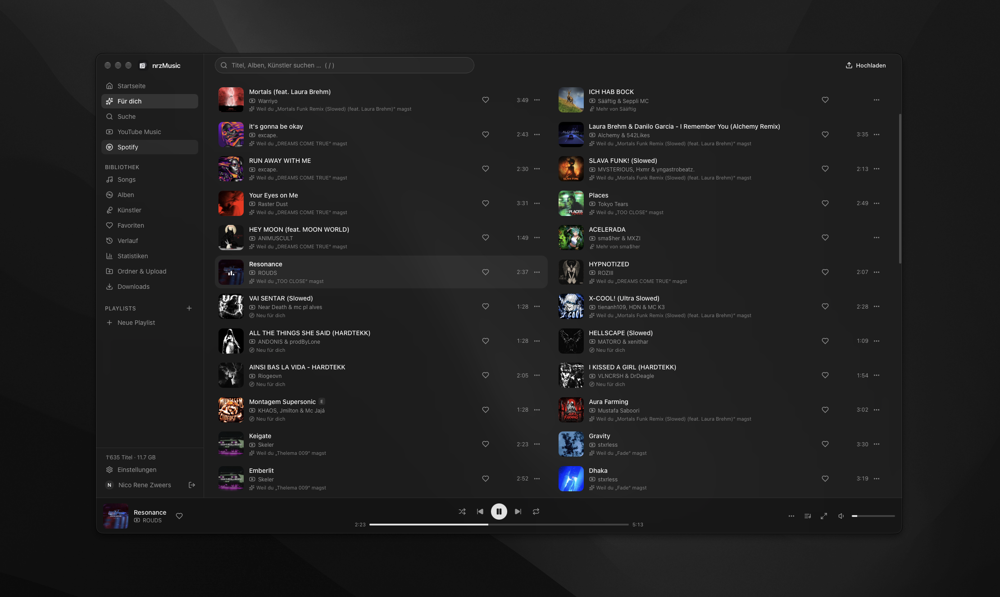

# nrzMusic

**English** — A Rust-powered music streaming server.

**Deutsch** — Ein in Rust geschriebener Musik-Streaming-Server.

**Español** — Un servidor de streaming de música escrito en Rust.

**Now playing / Jetzt läuft** — Opt-in sync between your devices (“Listening on MacBook · 1:23 / 3:45”, continue here) plus a copy-paste widget URL, a JSON API and an MCP server. / Sync zwischen deinen Geräten („Hört auf iPhone“, auf die Sekunde, hier weiterhören), dazu Widget-URL zum Einfügen, JSON-API und MCP-Server – in den Einstellungen einschalten. / Sincronización entre tus dispositivos, widget, API JSON y servidor MCP.

**macOS** — `cargo xtask macos` → `dist-macos/nrzMusic.app` + DMG: transparent window, works without a server or connected to your nrzMusic instance. / Durchsichtiges Fenster, läuft ohne Server oder verbunden mit deiner nrzMusic-Instanz. / Ventana transparente, funciona sin servidor o conectada a tu instancia de nrzMusic.
